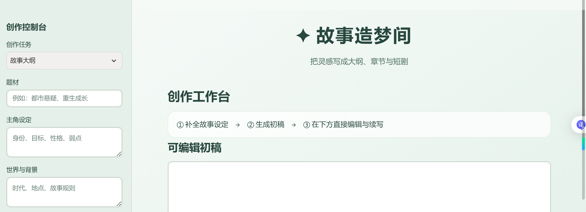

# 故事造梦间 · AI 网文 / 小说 / 短剧剧本生成器

> ✦ 把灵感写成大纲、章节与短剧

一个基于 **Streamlit + LangChain + DeepSeek（OpenAI 兼容接口）** 的 AI 创作 Web 应用。在左侧填好题材、主角、世界观和爽点，即可一键生成故事大纲、网文章节正文或可拍摄的短剧剧本；初稿可在页面上直接编辑、续写、修改，并导出 Markdown 保存。

## 🖼️ 界面预览



---

## ✨ 功能特性

- **三种创作任务**
  - 📋 **故事大纲**：一句话核心、人物关系、故事规则、分卷 / 分集大纲、核心冲突与结尾走向
  - 📖 **网文章节**：可直接阅读的章节正文，开头尽快进入冲突，结尾留下阅读钩子
  - 🎬 **短剧剧本**：按场次编号，写明场景、时间、人物、动作与对白，每场推动冲突并设置反转 / 悬念
- **完整创作流程**：补全设定 → 生成初稿 → 在编辑器中直接修改 → 续写 / 改稿
- **续写与改稿**：支持「续写（接在原文后）」和「修改（替换原文）」两种后续操作，保持人物、设定与文风一致
- **可调参数**：篇幅（短 / 中 / 长）、创意程度（temperature 0.1–1.2）
- **结果导出**：一键下载 Markdown 文件，草稿仅保留在当前会话中
- **密钥安全**：API Key 只从本地 `.env` 或部署环境的 Secrets 读取，页面不接收、不展示密钥；报错信息中的密钥会自动脱敏
- **界面**：薄荷绿莫兰迪配色，宽屏布局，支持移动端自适应与减弱动画偏好

## 🖼️ 界面预览

| 创作控制台（左侧边栏） | 创作工作台与可编辑初稿 |
| --- | --- |
| 题材、主角设定、世界背景、关键词 / 爽点、本次要求、篇幅与创意程度 | 生成进度条、可编辑初稿、续写 / 修改要求、下载 Markdown、清空草稿 |

> 在线体验（Streamlit Cloud 部署地址以仓库 About 栏为准）。

## 🧱 技术栈

- **前端 / 界面**：[Streamlit](https://streamlit.io/)
- **大模型接入**：[LangChain](https://python.langchain.com/) · `langchain-openai`（`ChatOpenAI`，OpenAI 兼容接口）
- **默认模型**：DeepSeek `deepseek-chat`（可通过环境变量切换为其他兼容 OpenAI 接口的模型）
- **环境变量**：`python-dotenv`
- **Python**：3.11.9

## 📁 目录结构

```
ai-novel-screenwriter/            # 仓库名（原 AI-projects）
├── novel_script_ai/              # 当前主应用（故事造梦间）
│   ├── app.py                    # Streamlit 主程序：设定面板、生成、续写 / 改稿、导出
│   ├── requirements.txt          # Python 依赖
│   ├── runtime.txt               # Streamlit Cloud 指定的 Python 版本
│   ├── .env.example              # 环境变量示例（复制为 .env 后填写）
│   ├── .gitignore
│   └── README.md                 # 本文件
└── streamlit_app.py              # 早期版本：网文 + 短剧双模式生成器（历史保留）
```

## 🚀 快速开始

### 1. 环境准备

- Python 3.11+
- 一个 DeepSeek（或其他 OpenAI 兼容服务）的 API Key

### 2. 克隆并安装依赖

```bash
git clone https://github.com/fsy357/ai-novel-screenwriter.git
cd ai-novel-screenwriter/novel_script_ai

# 建议使用虚拟环境
python -m venv .venv
# Windows
.venv\Scripts\activate
# macOS / Linux
# source .venv/bin/activate

pip install -r requirements.txt
```

### 3. 配置环境变量

复制示例文件并填入你的密钥：

```bash
# Windows PowerShell
Copy-Item .env.example .env

# macOS / Linux
# cp .env.example .env
```

编辑 `.env`：

```ini
# 必填：你的大模型 API Key
DEEPSEEK_API_KEY=sk-xxxxxxxxxxxxxxxx

# 选填：OpenAI 兼容接口地址，默认 DeepSeek 官方地址
DEEPSEEK_BASE_URL=https://api.deepseek.com/v1

# 选填：模型名称，默认 deepseek-chat
DEEPSEEK_MODEL=deepseek-chat
```

### 4. 启动应用

```bash
streamlit run app.py
```

浏览器打开终端提示的地址（默认 `http://localhost:8501`）即可开始创作。

## 🔧 配置说明

| 环境变量 | 是否必填 | 默认值 | 说明 |
| --- | --- | --- | --- |
| `DEEPSEEK_API_KEY` | ✅ 必填 | — | 大模型服务的 API Key，不会写入代码或页面 |
| `DEEPSEEK_BASE_URL` | 选填 | `https://api.deepseek.com/v1` | OpenAI 兼容接口的 Base URL，可切换到其他服务商 |
| `DEEPSEEK_MODEL` | 选填 | `deepseek-chat` | 调用的模型名称 |

> 本地开发可放在 `.env`；部署到 Streamlit Cloud 时，在应用的 **Settings → Secrets** 中按相同键名配置即可，无需提交 `.env`（已在 `.gitignore` 中排除）。

## ☁️ 部署到 Streamlit Cloud

1. 将代码推送到 GitHub 仓库；
2. 登录 [share.streamlit.io](https://share.streamlit.io/)，选择本仓库 `ai-novel-screenwriter` 的 `novel_script_ai/app.py`；
3. 在应用 Secrets 中填入 `DEEPSEEK_API_KEY`（及可选的 Base URL / 模型名）；
4. 部署完成后即可通过公网链接访问。

## 📝 使用说明

1. **选择创作任务**：故事大纲 / 网文章节 / 短剧剧本；
2. **填写设定**：题材、主角设定（身份、目标、性格、弱点）、世界与背景、关键词 / 情绪爽点、本次具体要求；
3. **调整篇幅与创意程度**，点击「✦ 生成初稿」；
4. 在「可编辑初稿」中直接修改文字；需要继续写或改稿时，填写本次要求并选择「续写」或「修改」；
5. 满意后点击「下载 Markdown」保存创作结果。

### 输入限制（代码内置）

- 本次具体要求：≤ 8000 字符；主角设定、世界背景：≤ 3000 字符
- 续写 / 改稿时草稿：≤ 16000 字符，超出需先精简

## ⚠️ 免责声明

本工具生成的内容由大模型根据用户设定产出，仅供创作参考；请自行核对情节、人物与合规性，不要直接照搬受版权保护的作品。生成内容不代表作者立场。

## 📄 License

本仓库未指定开源许可证，默认保留所有权利；如需开源，请在后续补充 LICENSE 文件。
